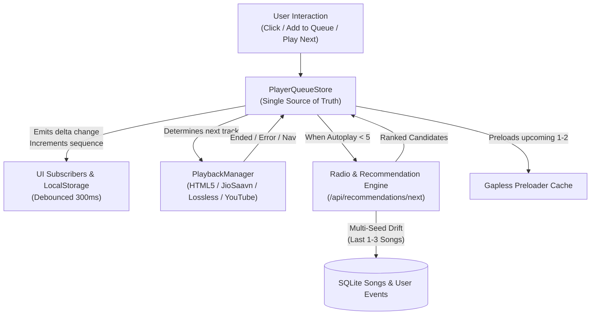

# BASA Architecture — Unified Queue & Recommendation Engine

This document outlines the architecture, data flow, and runtime guarantees of the unified queue system, next/previous navigation, and autoplay (radio) engine in BASA.

---

## 1. High-Level Flow Diagram



---

## 2. Unified Queue State & Data Model

The central queue is owned by a single reactive instance of `PlayerQueueStore` ([`public/playerQueueStore.js`](file:///c:/Users/9c23s/OneDrive/Documents/sengodi/web%20development/public/playerQueueStore.js)).

### Queue Entry Structure
Every item in the queue is wrapped in a distinct entry:
```javascript
{
    queueItemId: "qi_m4abc123_x89f", // Unique ID allowing the same song to appear multiple times
    song: {
        id: "song_123",
        title: "Song Title",
        artist: "Primary Artist",
        album: "Album Name",
        duration: 215,
        audioUrl: "https://...",
        coverUrl: "https://...",
        language: "Telugu",
        mood: "energetic",
        vibe_tags: "workout, party",
        energy: 0.85,
        tempo_bpm: 128
    },
    source: "PLAY_NEXT" | "USER_ADDED" | "CONTEXT" | "AUTOPLAY"
}
```

### Store State
- `items[]`: Array of `QueueItem` entries representing the active timeline.
- `currentIndex`: The index in `items[]` of the currently playing track.
- `history[]`: Chronological stack of previously played items (capped at 50).
- `shuffle`: Boolean flag indicating whether the shuffle bag is active.
- `repeat`: `'off'` | `'all'` | `'one'`.
- `sequence`: Monotonically increasing counter incremented on every delta mutation.
- `undoStack[]`: Stack of recent removal and clear actions for single-click rollback.

---

## 3. Playback Priority & Navigation Rules

### Next Track Priority Order
When `next()` is called or a song finishes naturally, upcoming tracks are consumed in strict tier order:
1. **`PLAY_NEXT`**: Explicitly marked by user to play immediately after the current song.
2. **`USER_ADDED`**: Added by the user via "Add to Queue".
3. **`CONTEXT`**: The remainder of the current album, playlist, or search context.
4. **`AUTOPLAY`**: Algorithmically generated endless radio continuation.

### Previous Track Navigation (3-Second Rule)
- If the current song has been playing for **more than 3.0 seconds**, calling `previous()` restarts the song from `0:00`.
- If playing for **3.0 seconds or less**, calling `previous()` pops the last played item from `history[]`, sets it as the current track, and places the outgoing track at the front of upcoming items.

### Rapid-Click Protection
All navigation triggers (`next`, `previous`, headset controls, MediaSession) enforce a 250ms guard window to prevent race conditions during rapid clicking.

---

## 4. Non-Destructive Shuffle Bag

Traditional random shuffling mutates the array destructively and allows repetitive cycles. BASA implements a **Shuffle Bag**:
1. When shuffle is enabled, upcoming items are shuffled using Fisher-Yates and stored alongside a snapshot of the `unshuffledOrder`.
2. Songs are drawn from the bag so every song plays once without repetition.
3. When shuffle is disabled, the exact original playlist order is restored for all remaining unplayed tracks.

---

## 5. Smarter Autoplay Refill & Natural Drift

- **Refill Trigger**: When fewer than 5 `AUTOPLAY` songs remain in upcoming items, a debounced, lock-protected request queries `/api/recommendations/next`.
- **Multi-Song Seed Drift**: The recommendation engine seeds from the **last 1–3 played songs** using time-decay weights (50% current, 30% previous, 20% older) so the radio drifts smoothly over time.
- **Weighted Re-ranking**:
  - Artist Match: `0.25`
  - Language Match: `0.20`
  - Mood & Vibe Tags: `0.20`
  - Music Director & Actor Match: `0.15`
  - Energy & BPM Closeness: `0.10`
  - Genre & Era: `0.10`
- **Behavioral Adjustments**:
  - Liked song: `+0.20`
  - Replayed song: `+0.15`
  - Completed song (>80%): `+0.12`
  - Skipped within 30s: `-0.30`
- **Guardrails**:
  - **50-Play Repeat Distance**: Strictly excludes any song played within the last 50 tracks.
  - **Consecutive Artist Cap**: Maximum of 2 consecutive songs by the same artist.
  - **70/30 Diversity**: 70% similar songs and 30% discovery songs.
  - **Autoplay-Only Deduplication**: Drops duplicate songs in autoplay while never touching songs manually added by the user.
  - **Capacity Cap**: Upcoming autoplay items are strictly capped at 25.

---

## 6. Listening Signals & Privacy

- Signals are logged to SQLite (`user_events`):
  - `play`: Ingested when a track starts.
  - `skip`: Recorded with seconds listened if stopped within 30s.
  - `complete`: Recorded when played > 80% or natural end.
  - `like`: Recorded when toggled.
  - `replay`: Recorded when user replays a song.
- **User Privacy**: `DELETE /api/events` allows the user to clear all stored listening signals.

---

## 7. Sync Room Architecture (Heartbeat Separation)

To ensure low latency and prevent packet bloat:
1. High-frequency playback ticks transmit only lightweight metadata:
   ```json
   {
       "type": "PLAY",
       "track": { ... },
       "position": 45.2,
       "queueSeq": 14,
       "queueIndex": 2,
       "queueLength": 18
   }
   ```
2. The heavy queue array is only transmitted when the queue sequence changes (`SET_QUEUE`).
3. If a peer detects a mismatch between its local `queueSeq` and the incoming `queueSeq`, it requests the full queue via `REQUEST_FULL_QUEUE`.

---

## 8. Playback Reliability & Gapless Preloading

- **Gapless Preloader**: Pre-buffers the next 1–2 audio streams in background elements.
- **Auto-Retry & Fallback**: If an audio stream fails to load, `PlaybackManager` retries via local audio proxy. If still unreachable, it displays a toast notification (`⚠️ Unable to stream "Title". Skipping to next track...`) and advances automatically to the next queue item.
